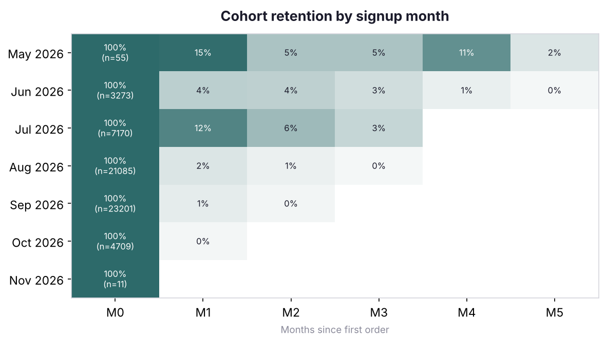
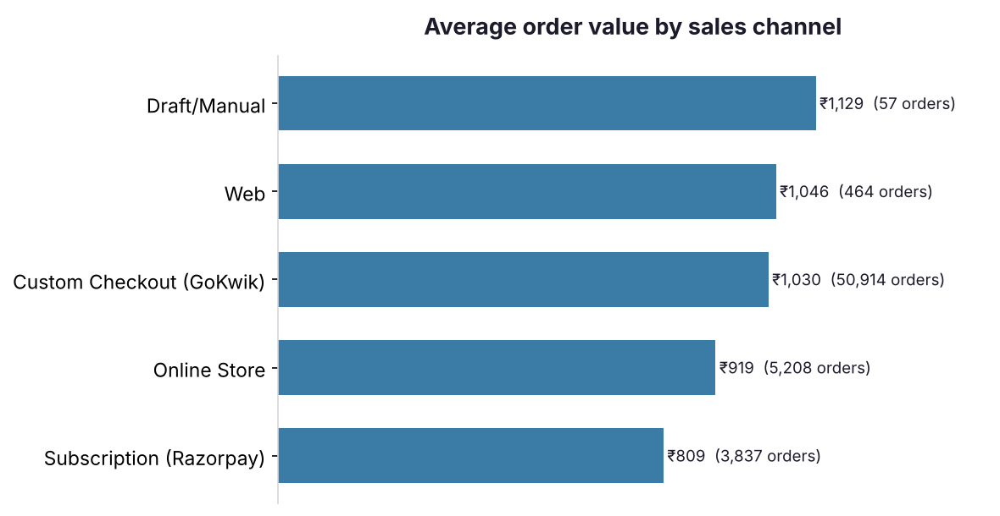
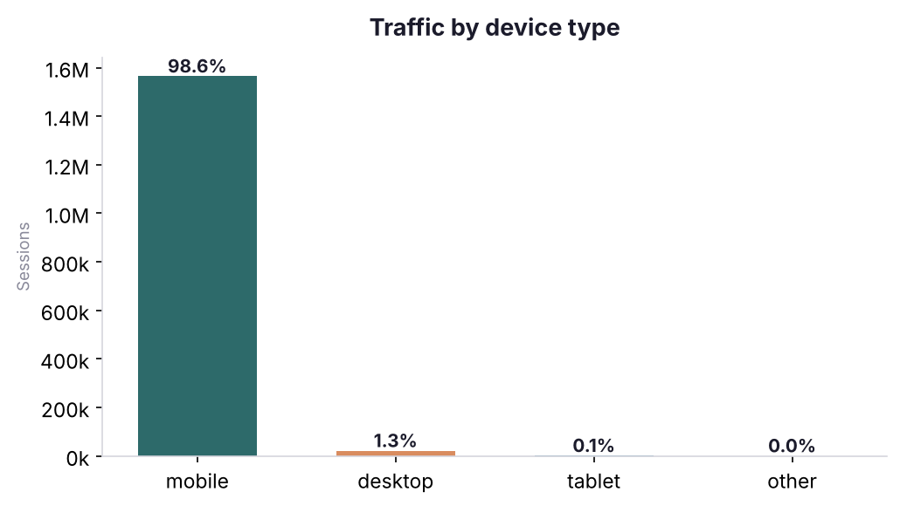
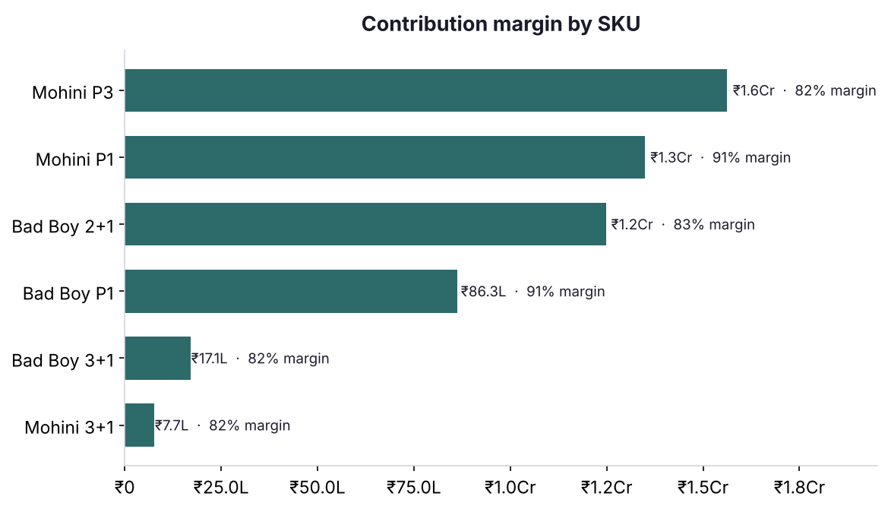

# D2C E-commerce Analytics (SQL)

SQL analysis of **~64,000 real orders** from a direct-to-consumer fragrance brand in
India — a store I work with as creative strategist, analysed with the brand's
permission. Order, customer and session data was loaded into PostgreSQL and analysed
for retention, channel performance, device behaviour, and unit economics (Jun–Nov 2026).

Each question below is answered with a single SQL query and a chart built from the
result. The queries live in [`sql/`](sql/), the charts are generated by
[`charts.ipynb`](charts.ipynb).

> **Note on the data.** This is a real brand's data, used with permission and
> anonymised for this project: customer emails are hashed to anonymous IDs, no personal
> details are included, and every monetary value is multiplied by a constant factor so
> the brand's real figures stay private. Because the factor is constant, every ratio,
> rate and trend is exactly preserved — only absolute rupee amounts are obfuscated.

---

## The data

| Table | Grain | Rows |
|---|---|---|
| `orders` | one row per order | 64,323 |
| `order_items` | one row per line item | 65,708 |
| `customers` | one row per customer | 68,627 |
| `products` | one row per SKU (with landed cost) | 6 |
| `device_sessions` | sessions by device (aggregate) | 4 |

Source: the store's own Shopify exports (orders, customers, sessions-by-device).
Cleaning, anonymisation and the money-scaling are done in
[`prepare_data.py`](prepare_data.py); the schema is in
[`sql/01_schema.sql`](sql/01_schema.sql).

A real-world wrinkle handled throughout: this store is COD-heavy, so ~19% of orders
sit in `partially_paid` / `pending`. Revenue questions count `paid` +
`partially_paid` and exclude `pending`/cancelled, which is noted where it matters.

---

## 1. What share of customers buy more than once?

**Query:** [`sql/02_analysis.sql`](sql/02_analysis.sql) · Q1

```sql
select
    count(*)                                              as customers,
    count(*) filter (where total_orders > 1)              as repeat_customers,
    round(100.0 * count(*) filter (where total_orders > 1) / count(*), 2) as repeat_rate_pct
from customers
where total_orders > 0;
```

**Finding:** **5.4%** of customers place a second order (3,241 of 60,011 buyers);
average orders per customer is 1.07. For a young D2C brand driven by cold paid
traffic that's a realistic — and improvable — repeat rate. The opportunity is
retention: the store acquires well but rarely gets a second purchase.

---

## 2. How does retention differ by signup month?

**Query:** [`sql/02_analysis.sql`](sql/02_analysis.sql) · Q2 (cohort triangle via `date_trunc` + `age`)



**Finding:** The **July cohort retains ~3× better** (12% back in month 1) than the
much larger **August–September cohorts** (1–2%). Those two months are a viral
spike — order volume jumped ~3× — but the customers acquired then came back far
less. **Scaling the acquisition spike brought in lower-quality, one-and-done
buyers.** That's the single most important finding here: raw order growth hid a
collapse in cohort quality.

---

## 3. Which sales channel drives the biggest orders?

**Query:** [`sql/02_analysis.sql`](sql/02_analysis.sql) · Q3

```sql
select channel, count(*) as orders, round(avg(total),2) as aov, round(sum(total),2) as revenue
from orders
where financial_status in ('paid','partially_paid','partially_refunded')
group by channel
order by revenue desc;
```



**Finding:** The **custom checkout (GoKwik)** handles the overwhelming majority of
orders (50,914) *and* posts a higher AOV (₹1,030) than the subscription channel
(₹809). Overall AOV is ₹1,006. The custom-checkout bet is paying off on both volume
and basket size — worth protecting and optimising further.

---

## 4. What device is the audience on, and how does it convert?

**Query:** [`sql/02_analysis.sql`](sql/02_analysis.sql) · Q4



**Finding:** **98.6% of sessions are mobile** — this is a near-entirely mobile
audience, with a blended conversion rate of 4.1% (64k orders / 1.59M sessions).
Any CRO, page-speed, or checkout work should be mobile-first to the point of being
mobile-only; desktop is a rounding error. *(Sessions are aggregate Shopify
analytics and can't be joined to individual orders, so this is a blended rate, not
a per-session funnel — noted as a data limitation.)*

---

## 5. Which products actually make the money?

**Query:** [`sql/02_analysis.sql`](sql/02_analysis.sql) · Q5 (revenue − cost, per SKU)

```sql
select
    i.sku, p.product_name,
    sum(i.quantity)                                        as units_sold,
    round(sum(i.quantity * i.unit_price), 2)               as gross_revenue,
    round(sum(i.quantity * p.cost_per_unit), 2)            as total_cost,
    round(sum(i.quantity * i.unit_price)
        - sum(i.quantity * p.cost_per_unit), 2)            as contribution_margin,
    round(100.0 * (sum(i.quantity*i.unit_price) - sum(i.quantity*p.cost_per_unit))
                / nullif(sum(i.quantity*i.unit_price),0), 1) as margin_pct
from order_items i
join products p on p.sku = i.sku
where p.cost_per_unit is not null
group by i.sku, p.product_name
order by contribution_margin desc;
```



**Finding:** Single bottles run **~91% contribution margin**; bundles ~82% (a
"buy-2-get-1" gives a bottle away, so margin per unit drops). But the **Mohini
Pack-of-3 bundle is the #1 total contribution driver** despite its lower margin
rate — volume beats rate. The takeaway: bundles are doing exactly their job
(bigger baskets at acceptable margin), and the product mix is healthy. Landed cost
is ₹90/bottle; margins this high are typical of the attar category.

*(Monthly revenue trend is also in the notebook — the Aug–Sep spike and Oct
normalisation, chart 5.)*

---

## Running it yourself

Needs PostgreSQL and Python (pandas, matplotlib).

```bash
# 1. clean + anonymise the raw exports -> clean/*.csv
python prepare_data.py

# 2. create schema + load
createdb ecommerce
psql -d ecommerce -f sql/01_schema.sql
psql -d ecommerce -c "\copy customers from 'clean/customers.csv' csv header"
psql -d ecommerce -c "\copy orders from 'clean/orders.csv' csv header"
psql -d ecommerce -c "\copy order_items(order_name,sku,product_name,quantity,unit_price,line_discount) from 'clean/order_items.csv' csv header"
psql -d ecommerce -c "\copy products from 'clean/products.csv' csv header"
psql -d ecommerce -c "\copy device_sessions from 'clean/device_sessions.csv' csv header"

# 3. run the analyses
psql -d ecommerce -f sql/02_analysis.sql

# 4. charts
jupyter notebook charts.ipynb
```

## Repo layout

```
├── sql/
│   ├── 01_schema.sql        tables, keys, indexes
│   └── 02_analysis.sql      the 5 analyses (question-per-block)
├── prepare_data.py          clean + anonymise + scale the raw exports
├── charts.ipynb             builds the 5 charts from query results
├── charts/                  the rendered PNGs
├── results/                 query outputs as CSV
├── data/                    data dictionary (raw exports not committed)
└── README.md
```

## Notes & assumptions

- **Money is scaled by a constant** to protect real figures; ratios/trends intact.
- **Emails hashed** to anonymous customer IDs; no PII in the repo.
- **COD orders:** `paid` + `partially_paid` count as revenue; `pending` excluded.
- **Margin** uses a flat ₹90/bottle landed cost (bundles × bottle count) — a
  reasonable estimate, not audited COGS.
- **Device/session data is aggregate** (Shopify analytics) and not joinable to
  orders, so #4 is a blended conversion rate by design.
- **Traffic source** = Shopify sales channel (the numeric channel IDs mapped to
  readable names in `prepare_data.py`), not UTM-level attribution.

---

*Tools: PostgreSQL · Python (pandas, matplotlib) · window functions, CTEs,
`filter`, cohort logic with `date_trunc`/`age`.*
